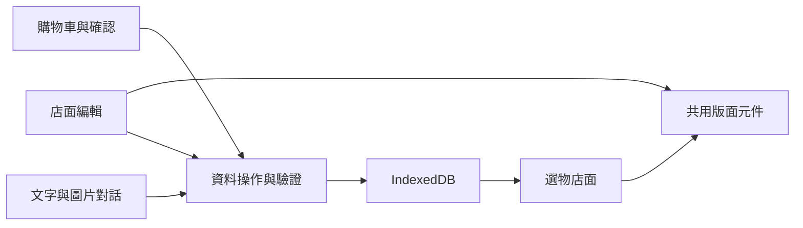

# 拾間選物｜店面編輯與購物體驗

`Nuxt 4` · `Vue 3` · `TypeScript` · `Element Plus` · `IndexedDB`

編排店面、確認選物、圖片對話，體驗從編輯到選購的完整互動。

**[體驗店面編輯](https://cutecat8110.github.io/stillroom-shop-demo/#/editor)** · **[逛逛店面](https://cutecat8110.github.io/stillroom-shop-demo/)**

| 入口 | 代表操作 |
| --- | --- |
| [店面編輯](https://cutecat8110.github.io/stillroom-shop-demo/#/editor) | 區塊排序、文字與圖片調整、復原重做、版型保存 |
| [商品選購](https://cutecat8110.github.io/stillroom-shop-demo/#/collection) | 分類搜尋、價格排序、規格與庫存 |
| [購物車](https://cutecat8110.github.io/stillroom-shop-demo/#/carts) | 數量調整、運費試算、單品／組合／贈品確認 |
| 客服對話 | 文字與圖片、送出前預覽、放大查看、對話保存 |

**試用順序：** 編排並儲存 → 選購「日常器物組」與單品 → 購物車確認 → 圖片對話。
登入頁的鑰匙按鈕可帶入帳密。

## 實作重點

- 編輯器與店面共用版面元件，支援桌面、平板與手機預覽。
- 型別化資料操作、交易寫入與版本檢查，避免跨分頁覆蓋。
- WebP 圖片、非首屏延後載入，編輯與對話元件分開載入。

共用架構

## 體驗說明

商品、帳號與對話均為展示資料，保存在目前瀏覽器。選物確認不建立實際訂單，沒有付款、出貨或真人客服；登入並非後端驗證。

重新整理保留已存內容，選物需重新確認。「重設資料」可恢復初始狀態。圖片僅在瀏覽器內處理，支援 PNG、JPEG、WebP，單張上限 2 MB。
