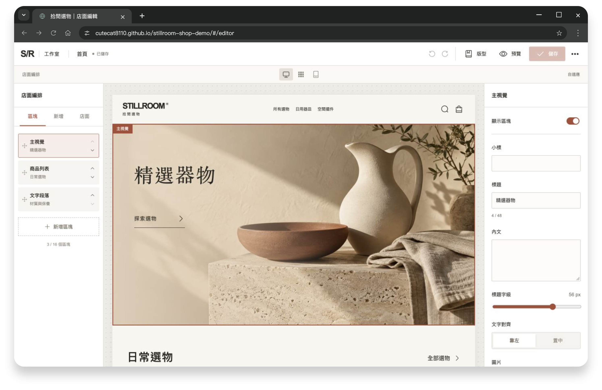
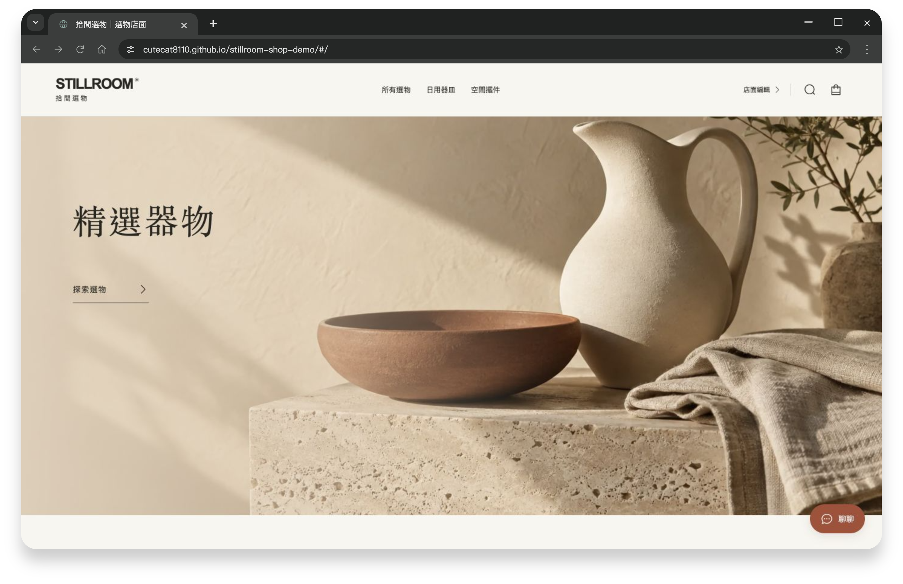
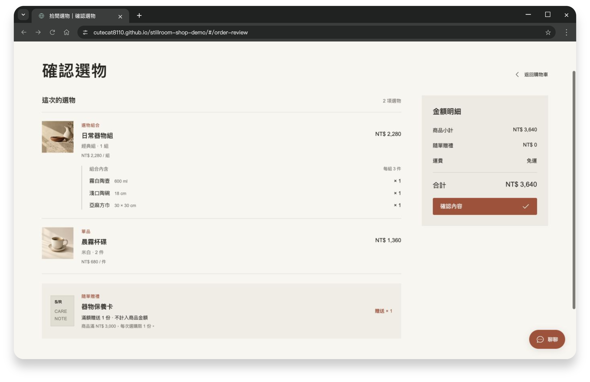

# 拾間選物｜店面編輯與購物體驗

`Nuxt 4` · `Vue 3` · `TypeScript` · `Element Plus` · `IndexedDB`

編排店面、挑選商品，再核對組合與贈品，搭配文字及圖片對話。

**[體驗店面編輯](https://cutecat8110.github.io/stillroom-shop-demo/#/editor)** · **[逛逛店面](https://cutecat8110.github.io/stillroom-shop-demo/)**

| 入口 | 代表操作 |
| --- | --- |
| [店面編輯](https://cutecat8110.github.io/stillroom-shop-demo/#/editor) | 區塊排序、圖文調整、復原重做與版型保存 |
| [商品選購](https://cutecat8110.github.io/stillroom-shop-demo/#/collection) | 分類搜尋、價格排序、規格與庫存 |
| [購物車](https://cutecat8110.github.io/stillroom-shop-demo/#/carts) | 數量、運費及單品／組合／贈品核對 |
| 右下角「聊聊」 | 文字與圖片、送出前預覽、放大查看 |

**試用：** 點鑰匙登入編輯器 → 編排並儲存 → 選購商品 → 確認選物 → 圖片對話。

店面與選物確認

實作重點

編輯器與店面共用版面元件，支援桌面、平板與手機預覽。WebP 圖片及非首屏延後載入；IndexedDB 交易與版本檢查避免跨分頁覆蓋。

使用說明

商品、帳號與對話為展示資料，保存在目前瀏覽器。確認選物不建立實際訂單，沒有付款、出貨或真人客服；登入並非後端驗證。

重新整理保留已存內容，選物需重新確認。「重設資料」恢復初始狀態。圖片僅在瀏覽器處理，支援 PNG、JPEG、WebP，單張上限 2 MB。

